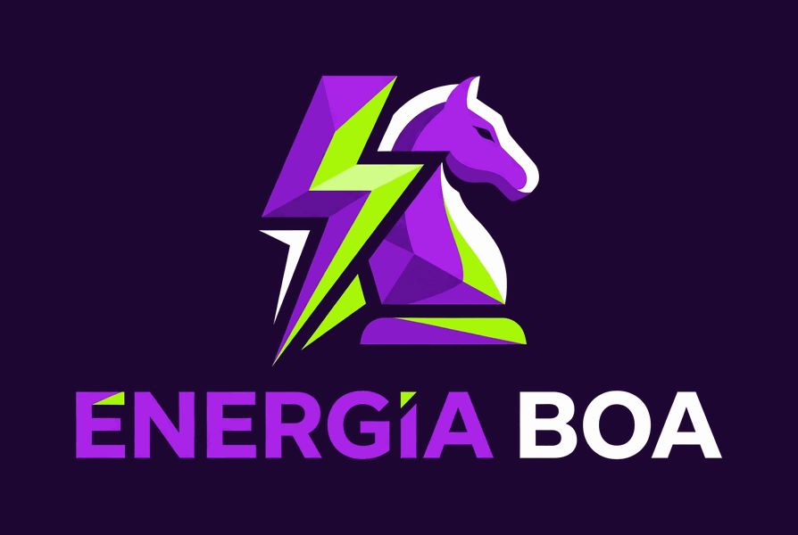

# Energia Boa



Jogos com vaga para arenas esportivas. MVP do time no Startup Weekend Araranguá (novembro de 2026). O visual segue o [design system](docs/design/01-design-system.md).

**Hipótese:** gente sem parceiro vira reserva num horário que a arena não vende.

Quem quer jogar marca o jogo (sozinho ou com um grupo incompleto), e a arena ou o time também abrem horários vagos. Quem quer entrar num jogo toca em **Procurar** e filtra por esporte, dia da semana e período do dia. O app mostra quem da base combina: mesmo esporte, mesmo nível (Iniciante, Intermediário ou Avançado) e horário que a pessoa marcou. A equipe convida pelo WhatsApp com a mensagem pronta, e o jogador confirma em um toque, sem conta e sem baixar app.

- App: https://danilosramos.github.io/mvp-sw/ (endereço oficial a definir — ver [decisão 6](docs/product/02-decisions-log.md))
- Convite de um jogo: `https://danilosramos.github.io/mvp-sw/#convite-<id>`

## 📚 Documentação

**Acesse [docs/00-INDEX.md](docs/00-INDEX.md) para navegação completa.**

Leitura recomendada por rol:
- **Negócio:** [Estratégia](docs/strategy/01-business-model.md) → [PRD](docs/product/01-prd-phase1-2.md) → [Arena Kickoff](docs/operations/arena-pilot-playbook.md)
- **Engenharia:** [Arquitetura](docs/architecture/01-architecture-overview.md) → [Dados](docs/architecture/02-data-model.md) → [Specs](docs/technical/01-technical-specs.md) → [Testes](docs/technical/04-testing-strategy.md)
- **Design:** [Design System](docs/design/01-design-system.md)
- **Auditoria:** [Achados](docs/decisions/01-audit-findings-2026-11-16.md) → [Blockers](docs/decisions/03-blockers-critical-path.md)

**Status Atual:**
- 🔴 Phase 1 Shippability: **4.5/10** — [Ver blockers](docs/decisions/03-blockers-critical-path.md)
- 🟠 3 Vulnerabilidades críticas: [Ver remediation](docs/decisions/02-security-issues-remediation.md)
- 🟡 71 Requisitos: [Ver PRD](docs/product/01-prd-phase1-2.md)


| Funciona de verdade | Fica de fora no MVP |
|---|---|
| Abrir jogo (horário vago ou grupo incompleto) | Pagamento |
| Quem combina (esporte, nível e horário) | Envio automático de mensagens |
| Convite pelo WhatsApp com mensagem pronta | App nativo, chat e avaliação |
| Confirmação pelo link ou pelo concierge | Integração com o sistema da arena |
| Placar ao vivo e reserva gerada em R$ | |
| Painel só com jogos reais (teste fica fora) | |

## Como está configurado

- **Firebase:** projeto `fechou-sw`, Firestore em `southamerica-east1` (São Paulo), com as regras de [`firestore.rules`](firestore.rules) publicadas.
- **Login da equipe:** Google. O domínio `danilosramos.github.io` está nos domínios autorizados do Firebase.
- **[`config.js`](config.js)** já aponta para o projeto.

### Colocar alguém no time

1. No rodapé do painel, toque em **Copiar convite para o time** e mande no grupo. A mensagem tem o link e o código do time.
2. A pessoa abre o link, toca em **Entrar com Google** e digita o código.

Se o código vazar, toque em **Trocar código**: o antigo para de funcionar para novas entradas. Quem já entrou continua no time; para tirar alguém, apague o documento dela na coleção `admins` do Firestore.

### Primeiro acesso

**Jogadores** > **Importar lista do formulário (.json)** > arquivo gerado das respostas do Tally.

O arquivo de jogadores tem nome e WhatsApp de pessoas reais: **nunca suba esse arquivo para este repositório**.

### Recriar do zero, em outro projeto Firebase

1. Crie um projeto em https://console.firebase.google.com.
2. **Firestore Database** > Criar banco de dados > São Paulo > modo de produção. Na aba **Regras**, cole `firestore.rules` e publique.
3. **Authentication** > Método de login > **Google** > Ativar. Em Configurações > **Domínios autorizados**, adicione o domínio do GitHub Pages.
4. **Configurações do projeto** > Seus apps > **Web (</>)** > copie o `firebaseConfig` para `config.js`.
5. No GitHub: Settings > Pages > **Deploy from a branch** > `main` / `(root)`.

## Como usar

Ver [docs/00-INDEX.md](docs/00-INDEX.md) para documentação organizada.

**Fluxo principal:**

1. Abre o app e toca em **Entrar com Google para marcar**. No primeiro acesso, preenche o perfil: cidade, esportes, nível, quando pode jogar e WhatsApp (opcional).
2. **Marcar jogo**: esporte, nível, dia e hora, arena, cidade, quantos são no total e quantos já são. Escolhe se o jogo é **público no app** ou **privado** (só com o link).
3. Manda o link nos grupos. Quem responder no WhatsApp, adiciona em **Confirmados**.
4. Quem faz check-in pelo link vê o WhatsApp de quem marcou (se informado) para combinar.
5. Em **Jogos abertos**, qualquer pessoa filtra os jogos públicos por data, cidade, esporte e nível.

**Time (arena ou concierge)**

1. Vê todos os jogos, inclusive os marcados por jogadores ("por Ana").
2. Em cada jogo, **Quem combina** lista a base: toque em **Convidar** para abrir o WhatsApp com a mensagem pronta.
3. Também marca jogos para horários vagos da arena. Em demonstrações, marque **Jogo de teste**: fica fora dos números do painel.

**Quem recebe o convite**: abre o link, escreve o nome e toca em **Tô dentro**. Sem conta e sem app.

## App instalável (PWA)

A Energia Boa pode ser instalada na tela inicial e abre sem internet (os jogos só aparecem com conexão). No Android, o app oferece "Instalar". No iPhone: Compartilhar > Adicionar à Tela de Início.

Para publicar uma versão que todos precisam receber, mude `VERSAO` no `sw.js`: quem estiver com o app aberto vê "Tem uma versão nova" e toca em Atualizar.

## Testes

```
pip install playwright && playwright install chromium
python3 tests/e2e.py   # fluxos de ponta a ponta, com backend simulado
python3 tests/pwa.py   # manifest, service worker, offline e atualização
```

Os dados dos testes são fictícios.

## Roteiro da demo (40 segundos)

1. Antes: cadastre o colega da plateia em **Jogadores** com o WhatsApp dele (vôlei de praia, nível 3, sábado à tarde ou noite).
2. No palco, ligue **Ocultar nomes**: os nomes reais da base viram apelidos.
3. **Marcar jogo**: **Privado** (assim o colega entra sem conta), arena, vôlei de praia, nível 3, próximo sábado às 18h, preço real, **Jogo de teste**.
4. Aparecem os jogadores reais que combinam. Toque em **Convidar** no colega.
5. Ele toca no link e em **Tô dentro**. No telão: **Fechou! Jogo confirmado**.

A data do jogo precisa ser futura: um jogo que já passou não aceita confirmação.

## Privacidade

- Só contas da equipe (coleção `admins`) leem os telefones dos jogadores. Quem abre um convite vê o jogo e o primeiro nome de quem confirmou.
- O WhatsApp de quem organiza só aparece para quem entrou no jogo com conta. Jogo público pede conta para entrar.
- O app não usa GPS e é para maiores de 18 anos. Detalhes na página **Privacidade e segurança** do app.
- Os valores de `config.js` são públicos por natureza. Quem protege os dados são as regras de `firestore.rules`.

## Arquivos

- `index.html`: o app inteiro (telas, regra de quem combina e mensagens).
- `firebase.js`: liga o app ao Firestore e ao login da equipe.
- `config.js`: configuração do projeto Firebase.
- `firestore.rules`: quem pode ler e escrever o quê.
