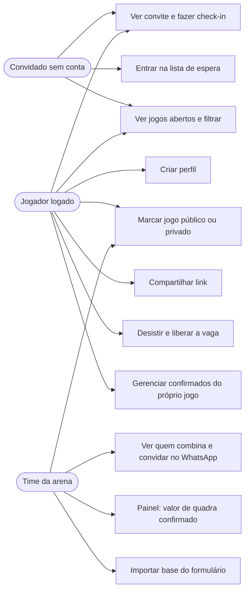
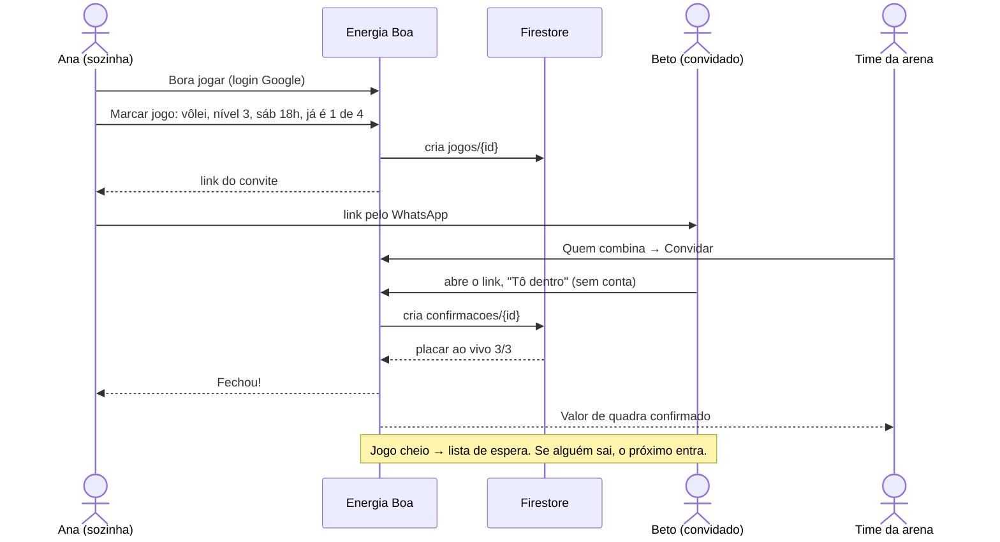
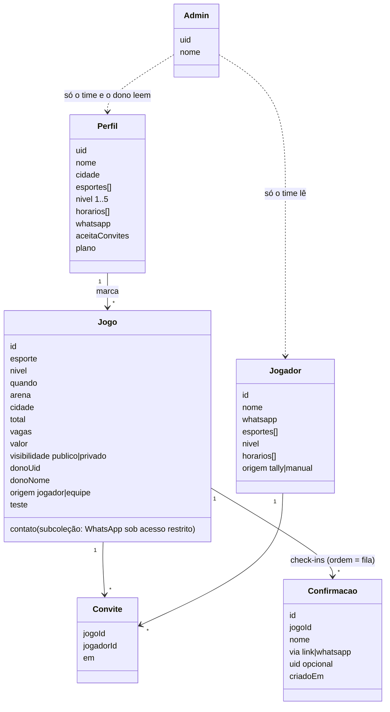
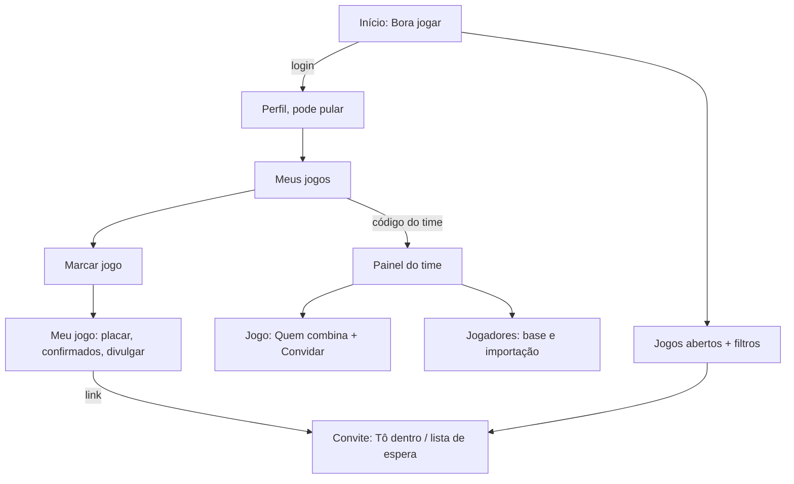
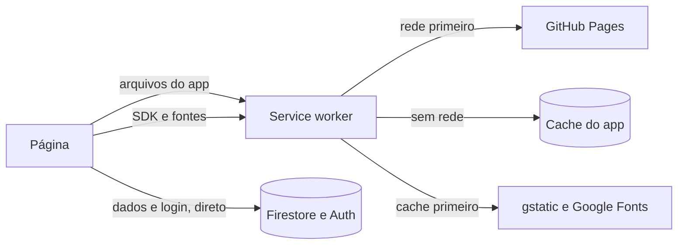

# Arquitetura da Energia Boa

> 📝 **Atualizado em 16/11/2026** após rebranding e alinhamento com schema Fase 2.
> Campos corrigidos: `donoZap` → `jogos/{id}/contato`, "Reserva gerada" → "Valor de quadra confirmado"

App de página única no GitHub Pages (`index.html`), com Firebase: login Google e Firestore ao vivo. Sem servidor próprio. As permissões ficam em `firestore.rules`.

## Casos de uso

## Jornada principal (a da demo)

## Dados (coleções do Firestore)

As primeiras `vagas` confirmações, por ordem de chegada, estão no jogo. As seguintes formam a lista de espera.

## Telas

## Quem pode o quê

| Dado | Qualquer um | Jogador logado | Time |
|---|---|---|---|
| Jogos e confirmações | lê | marca o próprio jogo, apaga o próprio | tudo |
| Check-in | cria com o nome | cria, e desiste do próprio | tudo |
| Perfis e base (WhatsApp) | nada | só o próprio perfil | lê tudo |
| Código do time | nada | usa para entrar | lê e troca |

## Atualização de 15/11/2026

- **Jogo** ganhou `tipoLocal` (`privada` ou `publica`). O campo `donoZap` ficou vazio: o WhatsApp de quem organiza mora em `jogos/{id}/contato/dono`.
- **Contato:** lido só pelo dono, pelo time e por quem tem a confirmação `confirmacoes/{jogoId}_{uid}`.
- **Confirmação com conta** tem id fixo `{jogoId}_{uid}`: uma por pessoa e por jogo. Jogo público só aceita confirmação com conta.
- **PWA:** `manifest.webmanifest`, `sw.js` (rede primeiro para o app, cache primeiro para SDK e fontes; dados nunca em cache), `offline.html`, `icons/`.
- **Nova tela:** Privacidade e segurança. A navegação fica na base da tela no celular.

